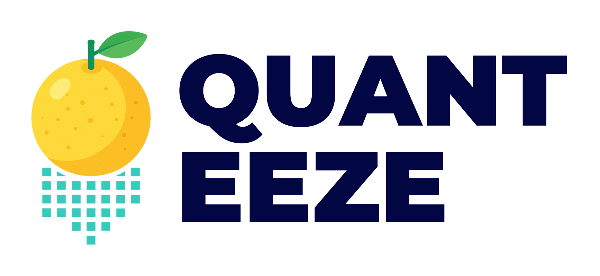
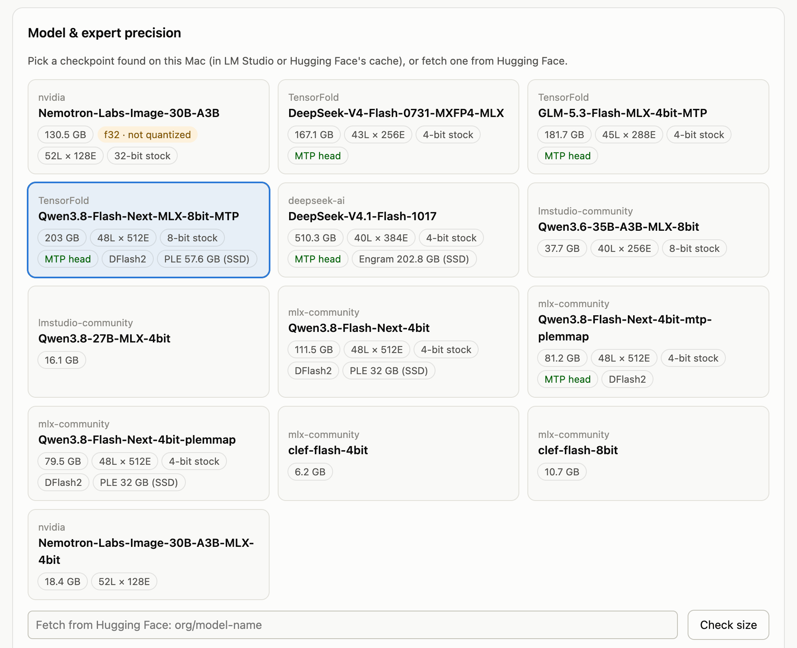
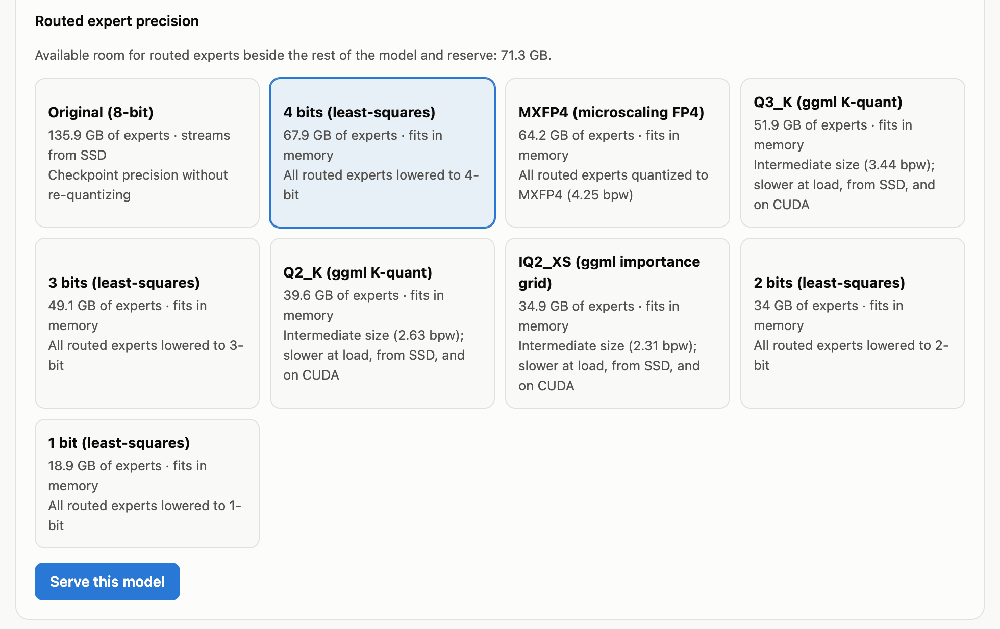
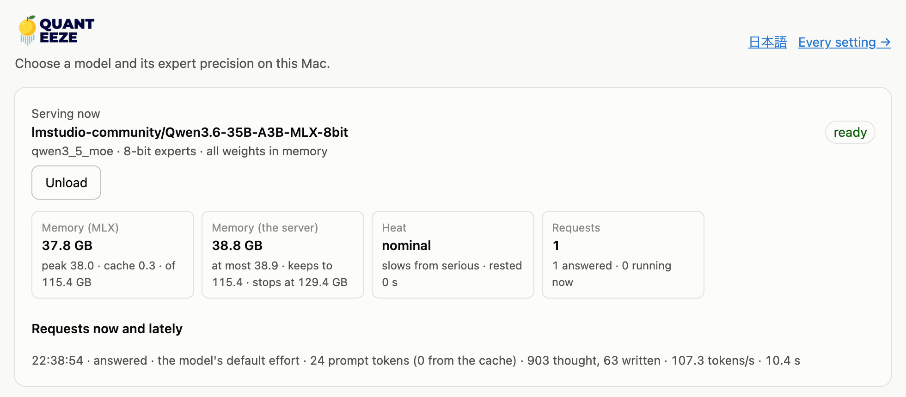
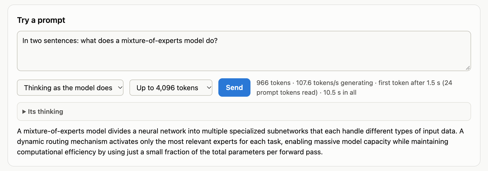
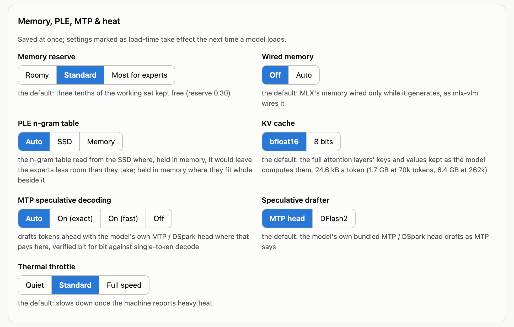
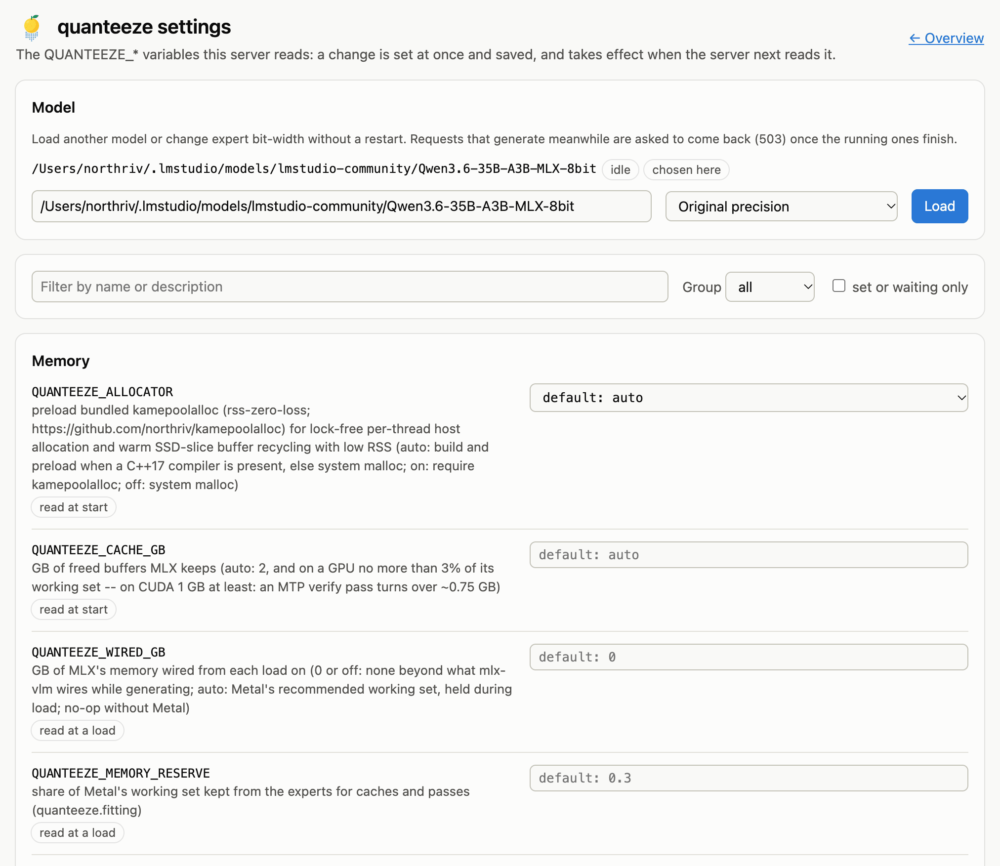

<h1 align="center">
  <picture>
    <source media="(prefers-color-scheme: dark)" srcset="docs/images/quanteeze-logo-dark-transparent.png">
    <source media="(prefers-color-scheme: light)" srcset="docs/images/quanteeze-logo-transparent.png">
    
  </picture>
</h1>

[](#license)
[](https://github.com/northriv/Quanteeze)


[](https://arxiv.org/abs/2608.12024)

**English** | **[日本語](README.ja.md)**

Fast MLX inference server for large Mixture-of-Experts (MoE) and dense language / vision-language models on **Apple Silicon (Metal)** and **NVIDIA GPUs (CUDA)**. Quanteeze combines uniform low-bit expert quantization, automatic on-demand SSD and host-RAM streaming powered by the formally verified lock-free C++20 [`kamestm`](https://github.com/northriv/KAME/tree/master/kamestm) STM engine and four-tier [`kamepoolalloc`](https://github.com/northriv/kamepoolalloc) pool allocator, bit-verified Metal/CUDA decode kernels, a built-in Browser UI, and native **OpenAI-compatible APIs (including Responses API for Codex CLI)** and **Anthropic Messages API (for Claude Code)** on a single port.

[Quick Start (macOS)](#quick-start-macos) · [Connect Apps (Claude Code / Codex / KAME)](#7-connecting-claude-code-codex-cli-and-other-apps) · [Linux (NVIDIA GPU)](#quick-start-linux--nvidia-gpu) · [Real-World Benchmark](#real-world-benchmark---experts-gguf) · [Architecture & Features](#architecture--features) · [Supported Models](#supported-models) · [Environment Variables](#environment-variables) · [Citing](#citing) · [License](#license)

---

## Quick Start (macOS)

This walkthrough covers installation, exploring models from the Browser UI, and connecting coding agents and apps such as Claude Code, Codex CLI, and KAME.

### 1. Prerequisites

- **Apple Silicon Mac** (32–48 GB+ Unified Memory recommended for large MoE models; models larger than physical memory also run via uniform 2–3 bit quantization or automatic SSD streaming), or a **Linux machine with an NVIDIA GPU** (see [Quick Start (Linux / NVIDIA GPU)](#quick-start-linux--nvidia-gpu)).
- **Free SSD space** for model checkpoints (tens to hundreds of GB depending on the model; fast external Thunderbolt / USB4 NVMe SSDs work well).
- **[uv](https://docs.astral.sh/uv/)** (automatically provisions Python 3.12+ and pinned dependencies):

```bash
curl -LsSf https://astral.sh/uv/install.sh | sh
```

> **Optional C++20 compiler**: When a C++20 compiler is present (`clang++` from Xcode Command Line Tools on macOS, or `g++` 10+ on Linux), Quanteeze automatically builds and enables the bundled lock-free four-tier host allocator [`kamepoolalloc`](https://github.com/northriv/kamepoolalloc) (`QUANTEEZE_ALLOCATOR=auto`) and C++20 native extensions (`QUANTEEZE_NATIVE=on`: the [`kamestm`](https://github.com/northriv/KAME/tree/master/kamestm)-backed STM on-demand engine `stm_core`, lock-free `pread` reader pool `native_reads`, and AVX2/AVX-512 `cpu_experts` on Linux x86-64) on first launch. Without a compiler, it falls back quietly to system `malloc` and pure Python implementations.

On macOS Unified Memory, Quanteeze automatically chooses between keeping all routed experts in memory and streaming them on demand from SSD based on whether the experts fit inside Metal's `max_recommended_working_set_size` minus `QUANTEEZE_MEMORY_RESERVE` (default `0.3`).

| Example Mac Configuration | Physical Memory | Typical Metal Recommended Working Set |
|---|---|---|
| Mac mini / MacBook Pro (M5 Pro) | 48 GB | ~40.2 GB |
| Mac Studio (M5 Ultra) | 96 GB | ~83.5 GB |
| MacBook Pro (M5 Max) | 128 GB | ~115.4 GB |

You can check your Mac's recommended working set with:

```bash
.venv/bin/python -c "import mlx.core as mx; print(round(mx.device_info()['max_recommended_working_set_size'] / 1e9, 1), 'GB')"
```

### 2. Clone and Install (macOS)

Cloning outside macOS TCC-protected folders (`~/Documents`, `~/Desktop`), such as `~/Quanteeze`, is recommended so coding agents like Claude Code can run commands without repeated macOS folder-permission prompts.

```bash
git clone https://github.com/northriv/Quanteeze.git ~/Quanteeze
cd ~/Quanteeze
uv sync
```

If using `pip`, run `pip install -e .` inside a Python 3.12+ virtual environment. `pyproject.toml` pins `mlx==0.32.4`, `mlx-lm==0.32.2`, `mlx-vlm==0.7.9`, and `nanobind==3.1.0` to guarantee kernel bit-verification reproducibility and C++ extension ABI stability. For Linux + NVIDIA GPUs, see [Quick Start (Linux / NVIDIA GPU)](#quick-start-linux--nvidia-gpu).

### 3. Models: Use Existing LM Studio or Hugging Face Folders Directly

- **MLX models downloaded in LM Studio** (`~/.lmstudio/models/<org>/<name>`) appear automatically in the Browser UI with zero copying (the trunk uses MLX `safetensors`; if you also have pre-distributed `UD-IQ*` GGUFs, `--experts-gguf` can stream routed experts directly from GGUF).
- **Hugging Face cache checkpoints** (`~/.cache/huggingface/hub`) are discovered automatically as well.
- **Checkpoints on an external SSD**: pass `--model <one-checkpoint-folder-on-that-drive>` at startup; sibling model folders under the same parent directory will also appear in the UI.
- If you do not have a checkpoint yet, enter a Hugging Face repo ID (`org/model-name`) in the Browser UI after starting the server to inspect total file count and size before downloading.

### 4. Start the Server

```bash
cd ~/Quanteeze
uv run quanteeze
```

By default the server listens on `127.0.0.1:8765`. Add `--model <checkpoint-dir>` to load a specific model immediately at startup, and `--enable-thinking` when serving reasoning agents. Press `Ctrl+C` to stop.

### 5. Open the Browser UI (Token-Guarded URL)

At startup, the terminal prints a line like:

```text
quanteeze: control routes ask for a token; Browser UI at http://127.0.0.1:8765/quanteeze/#token=..., all settings at http://127.0.0.1:8765/quanteeze/settings#token=...
```

- Open the `Browser UI at` URL (`/quanteeze/#token=...`) in your browser, **including the `#token=...` fragment at the end** (control actions are rejected without the token).
- The control token persists across restarts in `~/.quanteeze/control-token` (`0600`), so bookmarking the URL once works across future sessions.
- If you lose the URL, open `http://127.0.0.1:8765/quanteeze/`, paste the output of the command below into the **Token** field, and click **Use**:

```bash
cat ~/.quanteeze/control-token
```

### 6. Using the Browser UI

Work through the UI from top to bottom (switch between **English / 日本語** in the top-right corner, or open **Every setting →** at `/quanteeze/settings` for full configuration):

1. **Model & expert precision**
   Pick a local checkpoint, or enter `org/model-name`, click **Check size**, verify file count and total GB, and click **Download ... GB**.
   - **Converting unquantized float weights (`f32` / `bf16` / `f16`)**: Unquantized `safetensors` checkpoints are badged **`not quantized`**. When no model is loaded, clicking **Convert to 4 bits…** or **Convert to 8 bits…** lets you inspect the tool (`mlx-lm` or `mlx-vlm`), output directory (beside LM Studio models or in `~/.quanteeze/models`), estimated size, and free space before converting in an isolated process without executing repository custom code.

   
2. **Routed expert precision**
   For MoE models, the UI displays expert memory usage and whether each option **fits in memory** or **streams from SSD** across original precision, least-squares (**4 / 3 / 2 / 1 bit**), and **MXFP4 / Q3_K / Q2_K / IQ2_XS**.
   - **Rule of thumb**: pick the highest bit width marked **fits in memory** (if original precision fits, serve it as-is). To run models larger than memory, choose an option marked **streams from SSD**.

     Below, `Qwen3.8-Flash-Next-MLX-8bit-MTP` on a 128 GB Mac: its original 8-bit experts (135.9 GB) would stream from SSD, so **4 bits (least-squares)**, the highest option that fits in memory, is picked.

     
   - Click **Serve this model**. Live load progress, memory, thermal pressure, and throughput appear in **Serving now** at the top (along with a **`C++ STM`** badge when the [`kamestm`](https://github.com/northriv/KAME/tree/master/kamestm) on-demand engine is active).

     
   - **Unload / Load it again**: clicking **Unload** waits for in-flight generations to finish, releases model and cache memory, and returns HTTP 503 to new generation requests until you explicitly click **Load it again** or load another model — preventing connected background clients from immediately reloading weights into memory.
3. **Try a prompt**
   Send a test prompt directly from the browser (`Cmd+Enter` / `Ctrl+Enter`) to inspect responses, `tok/s`, and **Its thinking**.

   
4. **Memory, PLE, MTP & heat**
   One-click presets for common runtime controls:
   - **Memory reserve**: Comfortable / Standard / Most experts
   - **Wired memory** (macOS Metal only): **Off** (default; wired only while generating) / **Auto** (`QUANTEEZE_WIRED_GB=auto`: wires up to Metal's recommended working set from load onward to prevent pre-first-request macOS memory compression; macOS releases it automatically after ~30 s of GPU idle)
   - **PLE n-gram table**: Auto / SSD / Memory
   - **KV cache**: **bfloat16** / **8 bits** (`QUANTEEZE_KV_BITS=8` on Qwen3.8 Flash-Next at ~0.53x memory and plain-`KVCache` models such as Qwen3.8-27B at ~0.56x memory)
   - **MTP speculative decoding**: Auto / On (exact) / On (fast) / Off
   - **Speculative drafter**: switch between bundled **MTP head** and external **DFlash2** (`QUANTEEZE_DRAFTER`) on supported models, with size check and one-click download (falls back automatically to bundled MTP if unavailable)
   - **Thermal throttle** (macOS only): Quiet / Standard / Full speed

   
5. **Connect an app**
   Ready-to-copy OpenAI / Anthropic base URLs, Claude Code & Codex CLI launch commands, and `curl` snippets.

**Every setting →** (`/quanteeze/settings`) lists every `QUANTEEZE_*` variable by group with what it does, its default, and when the server reads it (at start, at a load, or per request); a change is saved to `~/.quanteeze/settings.json`. Its **Model** card loads another model or expert bit width without a restart.



### 7. Connecting Claude Code, Codex CLI, and Other Apps

Quanteeze serves **OpenAI-compatible** and **Anthropic-compatible** endpoints on the same port:

| API | Base URL | Typical Clients |
|---|---|---|
| OpenAI Chat Completions (`/v1/chat/completions`) | `http://127.0.0.1:8765/v1` | OpenAI SDK, KAME, general OpenAI-compatible apps |
| Anthropic Messages (`/v1/messages`) | `http://127.0.0.1:8765` | Claude Code, Anthropic SDK |
| OpenAI Responses (`/v1/responses`) | `http://127.0.0.1:8765/v1` | Codex CLI, Responses API clients |

- **Any model name or API key works**: whatever model name a client sends (`local`, `claude-...`, etc.), the model currently loaded in Quanteeze answers. Any API key string is accepted unless `--api-key` was set at startup.
- **Pass `--enable-thinking` for reasoning agents** (without it, thinking defaults to off unless explicitly requested per call).
- **Fast multi-turn agent loops**: Automatic Prefix Caching (APC) avoids re-prefilling shared conversation history across turns, and disk checkpoints are automatically sealed with convergent AES-256-GCM so plaintext tokens and KV states never sit on disk.
- **LAN access**: pass `--host 0.0.0.0` to accept connections from other machines on your LAN.

**Claude Code**

```bash
ANTHROPIC_BASE_URL=http://127.0.0.1:8765 ANTHROPIC_AUTH_TOKEN=local claude
```

**Letting Claude Code handle setup and launch**

Open Claude Code inside `~/Quanteeze` and ask:

> Follow the Quick Start in README.md to start Quanteeze. Use a model already in LM Studio or the Hugging Face cache; if none is present, tell me the download size before downloading. Once running, give me the full Browser UI URL including `#token=`.

**Codex (OpenAI Codex CLI & Desktop App)**

Add a Responses API (`/v1/responses`) provider and profile to `~/.codex/config.toml` (`requires_openai_auth = false` runs without OpenAI login and prevents ChatGPT OAuth tokens from being sent to a local/LAN server):

```toml
[model_providers.quanteeze]
name = "Quanteeze"
base_url = "http://127.0.0.1:8765/v1"
wire_api = "responses"
requires_openai_auth = false
stream_idle_timeout_ms = 7200000   # allow long prompt prefills / deep reasoning (default is 5 min)

[profiles.local]
model_provider = "quanteeze"
model = "local"
```

- **CLI**: run `codex --profile local`.
- **Desktop App**: place these two lines at the very top of `~/.codex/config.toml` (before the first `[...]` table), commenting out any existing top-level `model = ...` line:

  ```toml
  model_provider = "quanteeze"
  model = "local"
  ```

- If you started Quanteeze with `--api-key`, add `env_key = "MLX_VLM_SERVER_API_KEY"` under `[model_providers.quanteeze]` and export that variable in your shell.
- When using Codex approval auto-review (`[auto_review]`), raise `timeout_ms` (e.g. `300000`, supported in Codex 0.171.0+; `0` disables the deadline): each auto-review sends a ~20k-token freshly selected conversation excerpt that rarely hits the prompt cache and can easily exceed the 90 s default on large models:

  ```toml
  [auto_review]
  timeout_ms = 300000   # auto-review budget in ms (default: 90000)
  ```

One-liner without editing `config.toml` (also available in **Connect an app** in the UI):

```bash
codex -c model_provider="quanteeze" -c model="local" \
  -c 'model_providers.quanteeze={name="Quanteeze",base_url="http://127.0.0.1:8765/v1",wire_api="responses",requires_openai_auth=false,stream_idle_timeout_ms=7200000}'
```

- **Optional image-generation MCP tool (`quanteeze.image_mcp`)**: Because Quanteeze's inference server only serves text/VLM generation, `quanteeze.image_mcp` provides a standalone stdio MCP tool `generate_image(prompt, model, width, height, seed, path)` for Codex and other MCP clients. Any discovered checkpoint can be chosen via `model`; the default is the first found model from the top of the table below (commercial-friendly Apache-2.0 models prioritized first):

  | `model` | Model | License | Required local checkpoint | Typical 1024×1024 timing |
  |---|---|---|---|---|
  | `z-image-turbo` | Z-Image-Turbo (Tongyi-MAI, 6B) | Apache-2.0 (model card; no `LICENSE` file in repo) | `mlx-community/Z-Image-Turbo-bf16` (20.5 GB) | ~12 s (9 steps) |
  | `flux2-klein` | FLUX.2-klein-4B (Black Forest Labs) | Apache-2.0 | `black-forest-labs/FLUX.2-klein-4B` float weights (~16 GB; `mlx-community` 4/8-bit copies use `mflux` layout, not `mlx-vlm`) | — (supported when placed) |
  | `qwen-image` | Qwen-Image-2.1 | Qwen Research License (research/evaluation only) | `mlx-community/Qwen-Image-2.1-MLX-4bit` (10.5 GB) | ~44 s (30 steps) |
  | `nemotron-image` | Nemotron-Labs-Image-30B-A3B | NVIDIA License (research/evaluation only) | MLX 4/8-bit converted model (e.g. via **Convert to 4 bits…** in Browser UI) + original `Nemotron-Labs-Image-Tokenizer` | ~23 s |

  The first three models use `mlx-vlm`'s image pipelines (`quanteeze.vlm_image`, sizes 256–2048 px in steps of 16), and `nemotron-image` uses `quanteeze.nemotron_image` (512–1536 px in steps of 64). Place checkpoints under a discovered model directory (`~/.lmstudio/models`, `/Volumes/*/lmstudio`, or `~/.quanteeze/models`) and add to `~/.codex/config.toml`:

  ```toml
  [mcp_servers.images]
  command = "/path/to/Quanteeze/.venv/bin/python"   # absolute path to this repo's .venv Python
  args = ["-m", "quanteeze.image_mcp"]               # optionally add "--default", "flux2-klein", etc.
  tool_timeout_sec = 300
  ```

  - **Per-model licensing (NVIDIA License / Qwen Research License are non-commercial — research or evaluation only):** `Qwen-Image-2.1` (Qwen Research License) and `Nemotron-Labs-Image-30B-A3B` (NVIDIA License §3.3 — including converted checkpoints, generated PNG outputs, and [`src/quanteeze/vendor/nemotron_image/l24sq.py`](src/quanteeze/vendor/nemotron_image/l24sq.py) / [`LICENSE`](src/quanteeze/vendor/nemotron_image/LICENSE) / [`NOTICE.md`](src/quanteeze/vendor/nemotron_image/NOTICE.md)) are restricted to research or evaluation use only. For commercial products or client work, use `z-image-turbo` or `flux2-klein` (Apache-2.0). The MCP tool surfaces each model's license in its tool description and replies. No weights are distributed in this repository.
  - Each call checks free memory (model + 6 GB spare), loads the pipeline/model for one image, and releases it afterward. Outputs default to `~/.quanteeze/images/` (capped at 2 GB retained and 2 GB written per process via `--keep-gb` / `--write-gb`).

**Python (OpenAI SDK)**

```python
from openai import OpenAI

client = OpenAI(base_url="http://127.0.0.1:8765/v1", api_key="local")
r = client.chat.completions.create(
    model="local",
    messages=[{"role": "user", "content": "Hello!"}],
)
print(r.choices[0].message.content)
```

**[KAME](https://github.com/northriv/KAME) (Pydantic AI Agent)**

The physical-property measurement platform [KAME](https://github.com/northriv/KAME) connects via Pydantic AI's `OpenAIChatModel` (`/v1/chat/completions`). Add two lines to `~/.kame_pyai.env`:

```bash
KAME_PYAI_MODEL=local:quanteeze
KAME_PYAI_LOCAL_URL=http://127.0.0.1:8765/v1
```

- Launch Quanteeze with `--enable-thinking` for tool-using KAME sessions (Quanteeze raises the default `MLX_VLM_MAX_TOKENS` to `32768` so tool calls after long reasoning chains are not truncated, and repairs or re-asks malformed tool calls via `quanteeze.toolcalls` / `quanteeze.reask`).
- When running KAME in headless Docker (`kame-headless`), only KAME and its MCP server run inside the container while the Pydantic AI agent connects directly from the host to `127.0.0.1:8765`, so `--host 0.0.0.0` is unnecessary.

**curl**

```bash
curl http://127.0.0.1:8765/v1/chat/completions \
  -H "Content-Type: application/json" \
  -d '{
    "model": "local",
    "messages": [{"role": "user", "content": "Hello!"}]
  }'
```

---

### Quick Start (Linux / NVIDIA GPU)

Quanteeze runs natively on Linux with NVIDIA GPUs. When MoE experts exceed GPU VRAM, Quanteeze automatically caches experts and PLE / Engram tables (with pinned host memory for PLE/Engram) in **host RAM** (skipping redundant copies on integrated CUDA GPUs or `/dev/shm`) and streams misses over PCIe. On AVX2 / AVX-512 hosts with `g++`, `QUANTEEZE_CPU_EXPERTS=auto` (default) computes host-RAM decode misses (`B=1..8`) on NUMA-local physical CPU cores in parallel with GPU-resident experts — automatically yielding when other processes use the cpuset and running at normal priority inside batch schedulers. Lock-free GIL-free C++ `pread` workers (`QUANTEEZE_DEMAND_READ_NATIVE=auto`) parallelize SSD reads, and `QUANTEEZE_PARALLEL=auto` splits `qwen4_exp`, `glm5_next`, and `deepseek_v41` across multiple GPUs by layer.

**1. Prerequisites**

- **NVIDIA GPU** with drivers supporting CUDA 12+ (or CUDA 13; check `CUDA Version` in `nvidia-smi`).
- **Free SSD space** for checkpoints and ample **system RAM**.
- **[uv](https://docs.astral.sh/uv/)**: `curl -LsSf https://astral.sh/uv/install.sh | sh`
- **(Optional) C++20 `g++` (`g++` 10+)** to auto-build [`kamepoolalloc`](https://github.com/northriv/kamepoolalloc) and C++20 extensions (`stm_core`, `native_reads`, AVX2/AVX-512 `cpu_experts`), e.g. `sudo apt install g++` on Ubuntu/Debian.

**2. Clone and Install**

Install with the `cuda` (CUDA 12) or `cuda13` optional dependency group:

```bash
git clone https://github.com/northriv/Quanteeze.git ~/Quanteeze
cd ~/Quanteeze

# CUDA 12 (default)
uv sync --extra cuda

# Or CUDA 13
# uv sync --extra cuda13
```

> With `pip`, install via `pip install -e ".[cuda]"` (or `".[cuda13]"`). For CPU-only smoke testing without a GPU, use `uv sync --extra cpu`.

Verify that MLX sees your GPU (`Device(gpu, 0)`):

```bash
.venv/bin/python -c "import mlx.core as mx; print(mx.default_device())"
```

**3. Models**

Use checkpoints in Hugging Face's cache (`~/.cache/huggingface/hub`), pass `--model <checkpoint-dir>`, or download directly from the Browser UI after starting the server.

**4. Start the Server**

```bash
cd ~/Quanteeze
uv run --extra cuda quanteeze --port 8765
# Or invoke the virtualenv binary directly:
# .venv/bin/quanteeze --port 8765
```

> **Important**: On Linux, always include `--extra cuda` (or `--extra cuda13`) when running `uv run` or `uv sync`; running bare `uv run quanteeze` causes `uv` to uninstall `mlx-cuda-12`. Invoking `.venv/bin/quanteeze` directly needs no extra flags.

**5. Open the Browser UI via SSH Port Forwarding**

Because the server binds to `127.0.0.1:8765` by default, forward the port over SSH from your laptop/workstation and open the printed `#token=` URL locally:

```bash
ssh -N -L 8765:127.0.0.1:8765 <linux-host>
```

> **Note on Linux**: Thermal throttling (`QUANTEEZE_THROTTLE_AT`) is macOS-specific and inactive on Linux.

---

## Command-Line Launch Examples

```bash
# Serve at original checkpoint precision (in memory if it fits, else automatic SSD streaming)
uv run quanteeze --model /path/to/checkpoint

# Uniformly quantize all routed experts to 2-bit least squares
QUANTEEZE_BITS=2 uv run quanteeze --model /path/to/checkpoint

# Uniform 3-bit quantization cached on disk for instant subsequent startups
QUANTEEZE_BITS=3 QUANTEEZE_QUANT_CACHE=~/.quanteeze/quant-cache uv run quanteeze --model /path/to/checkpoint

# K-quant (Q2_K) + Compact mode (stream PLE/Engram, Vision, and Embeddings from SSD to maximize expert room)
QUANTEEZE_BITS=q2_k QUANTEEZE_COMPACT=on uv run quanteeze --model /path/to/checkpoint

# Keep trunk/Attention/PLE/Engram/Vision/MTP in MLX while streaming routed experts directly from UD-IQ* GGUF
# (accepts a single .gguf file, split *-00001-of-0000N.gguf shard, or directory of shards)
uv run quanteeze --model /path/to/DeepSeek-V4.1-Flash-1017 --experts-gguf /path/to/UD-IQ1_M

# Explicitly cap SSD expert resident bank and total process footprint when sharing a machine
QUANTEEZE_FROM_SSD_GB=16 QUANTEEZE_KEEP_GB=38 uv run quanteeze --model /path/to/mlx-checkpoint --experts-gguf /path/to/UD-IQ1_M

# Enable thinking mode and listen on all LAN interfaces
uv run quanteeze --model /path/to/checkpoint --enable-thinking --host 0.0.0.0 --port 8765
```

---

## Real-World Benchmark (`--experts-gguf`)

Measured on an Apple Silicon MacBook Pro (128 GB Unified Memory / M5 Max / internal NVMe SSD) serving `DeepSeek-V4.1-Flash-1017` (MLX) paired with Unsloth's `UD-IQ1_M` GGUF under default settings (`QUANTEEZE_FROM_SSD_GB` and `QUANTEEZE_KEEP_GB` unset; measured 2026-11-15):

- **Setup**:
  - **Base model (MLX)**: `DeepSeek-V4.1-Flash-1017` (Attention, FP8 projections, Engram, Vision, and 2-bit DSpark MTP head from the MLX checkpoint: **9.9 GB** resident trunk + **4.9 GB** DSpark MTP)
  - **Routed experts (`--experts-gguf`)**: Unsloth `UD-IQ1_M` (mixed per-layer/per-projection `IQ1_S` / `IQ2_XXS` / `IQ2_XS` / `IQ2_S`; **132.2 GB** total routed experts, **2.18x smaller** than the original **288.8 GB** MXFP4 experts)
  - **Automatic memory budget** (Metal recommended working set **115.4 GB**, `QUANTEEZE_MEMORY_RESERVE=0.3`): **71.0 GB** resident expert bank (**206 / 384 = 53.6%** of experts per layer kept in RAM, remaining misses streamed on demand from SSD)

Across 3 fixed prompts (English explanation, Python code generation, Japanese explanation) × 1 warm-up + 2 timed runs = 6 runs per setting (`max_tokens=512`, `temperature=1.0`, `top_p=0.95`, `top_k=20`):

| Setting | Load Time | Pure Decode (mean / median / min–max) | Wall Speed (mean / max, incl. prefill) | SSD Hit Rate | DSpark Acceptance | `gguf_qmv` Kernels | Peak Footprint (limit `115.4 GB`) |
|---|---|---|---|---|---|---|---|
| `QUANTEEZE_MTP=auto` (default, 2-bit DSpark ON) | 31.0 s | **16.5 tok/s** / 16.2 / 12.2–22.2 | 15.9 / 22.1 tok/s | 93.8% | **90.1%** (2.26 tok/round) | 0 mismatches (150,171 calls) | **91.0 GB** (0 over-limit) |
| `QUANTEEZE_MTP=off` (single-token decode) | 24.4 s | **13.5 tok/s** / 13.4 / 11.7–15.8 | 13.0 / 14.6 tok/s | 96.2% | — | 0 mismatches (292,158 calls) | **85.6 GB** (0 over-limit, +0.0 GB swap) |

### Multimodal Multi-Turn Agent, Restart APC & Concurrency (Apple M5 Max 128 GB, 2026-11-26)

Measured on the same **Apple M5 Max (128 GB Unified Memory / internal NVMe SSD)** serving checkpoints **in place (`0 GB` extra repacking)**:

#### 1. 43k–47k Multimodal Agent + Session Switch + Hard Server Restart (`Qwen3.8-Flash-Next-4bit-mtp-plemmap`)

- **Setup**: `QUANTEEZE_DRAFTER=dflash2` (4-bit `DFlash2`, 0.3 GB), `QUANTEEZE_KV_BITS=8`, AES-256-GCM disk-only APC (`0 GB` GPU APC footprint, **3.33 GB** sealed across 12 files on disk, **0** plaintext canary leaks), 42.8k–46.8k source-code context + 2 PNG screenshots, `temperature=0`, `0` kernel mismatches (`expert_qmv`, `hyper`, `linear_attn`, `8-bit KV`, `verify`). Startup took **15.5 s** cold / **11.5–12.0 s** on restart (sustained runs engaged macOS `thermal pressure 2` = 85% GPU duty cycle).

| Step | Prompt (+ 2 PNG Images) | Cached Tokens | TTFT | Prefill Speed | Decode Speed | Notes |
|---|---|---|---|---|---|---|
| **Turn 1 (Cold)** | 42,806 tok + 2 images | 0 | 47.45 s | 964.1 tok/s | 42.7 tok/s | Sealed 1.94 GB encrypted APC on disk |
| **Turn 2 (Warm)** | 44,271 tok + 2 images | **42,805** | **5.04 s** | **14,057.7 tok/s** | **54.3 tok/s** | 99.998% prefix hit via OS page cache |
| Competing Session B | 20,349 tok (text) | 0 | 20.34 s | 1,006.9 tok/s | 46.1 tok/s | Disjoint session; did not evict Session A |
| **Turn 3 (Return to A)** | 45,617 tok + 2 images | **44,270** | **5.23 s** | **11,488.1 tok/s** | **68.2 tok/s** | Final disk APC **3.33 GB** (0 leaks) |
| **Turn 4 (Post-Restart Restore)** | **46,842 tok + 2 images** | **45,616** | **10.20 s** | **14,162.5 tok/s** | **56.0 tok/s** | Restored from disk after full process restart |
| **Control: No APC (`APC_ENABLED=0`)** | **46,842 tok + 2 images** | 0 | **65.08 s** | 795.6 tok/s | 49.9 tok/s | **`6.38x`** post-restart TTFT speedup (`~12.9x` warm vs 47k cold); 4-turn total **78.5 s** |

- **Decode responsiveness under an 18.4k cold prompt arrival (`APC=0`)**: Launching an **18,389-token** cold prompt 1.5 s into a 320-token decode (`634` prompt tokens) let the active decode finish all 320 tokens cleanly at **59.5 tok/s** with **39.45 ms** max inter-token gap (**33.07 ms** P95, **30.92 ms** median; 24.0 s before the 18.4k prefill finished; peak **114.2 GB < 115.4 GB** limit, 0 OOM). Across clean `B = 1 / 2 / 4` bursts (~2.3k prompts, 200 generated tokens; re-measured 2026-11-27 with host-pipeline optimizations and `QUANTEEZE_EVAL_LAYERS=auto`), memory-aware admission held swap delta at **+0.0 GB** (peak **108.3 GB** MLX / **109.3 GB** footprint) while sustaining **69.4 / 73.3 / 74.3 tok/s** per-request decode (**486.6 / 498.0 / 455.2 tok/s** total `S`, aggregate `S_TG = 69.0 / 72.7 / 62.4 tok/s`; 2026-11-26 baseline: `476.7 / 493.6 / 440.8 tok/s`).
- **Metal decode host-pipeline & router optimization A/B (`MTP=off`, `KV=8bit`, re-measured 2026-11-27)**: Across 3 fixed prompts (English, Python, Japanese) × (1 warmup + 2 timed runs = 6 runs, `max_tokens=320`, `temperature=0`, thermal pressure `0`), combining `expert_qmv._plan`, `linear_attn._in_proj` dict caching, Metal conv window sliding, `QUANTEEZE_EVAL_LAYERS=auto` (`4` on Metal), and `QUANTEEZE_METAL_ROUTER=on` (`quanteeze.metal_router` routing + weighted sum kernels) accelerated single-token decode from **62.87 tok/s** (median **62.80**, range **62.7–63.1**) to **70.45 tok/s** (median **70.35**, range **70.2–70.8**, **+12.1%** overall; **67.48 tok/s** with `QUANTEEZE_METAL_ROUTER=off`) with **6/6 exact greedy output text parity** and **0 kernel mismatches**. Extending `quanteeze.metal_router` to multi-token speculative verify passes (`2..8` tokens) further accelerates `DFlash2` (`temperature=0`, 3 fixed prompts, thermal pressure `0`) from **84.15 tok/s** (up to **109.9 tok/s**) to **87.23 tok/s** (mean of 2 cool runs: **87.57 / 86.88 tok/s**, **+3.65%**, up to **114.2 tok/s** on Python code; bundled `MTP` at matched thermal pressure `1`: **75.52** → **78.07 tok/s**, **+3.38%**; 6/6 exact output parity, 0 mismatches).

#### 2. Multi-Model Zero-Repack Coverage on 128 GB Mac (`0 GB` Extra Disk Overhead)

| Model | Placement on 128 GB Mac | Load Time | Decode Speed (`temperature=0`) | Kernel Checks |
|---|---|---|---|---|
| `Qwen3.8-Flash-Next-4bit-mtp-plemmap` (`dflash2` / `MTP=off`, `KV=8bit`) | In-memory (**75.5 GB** experts) | 11.5–15.5 s | **70.2–70.8 tok/s** (`MTP=off` mean **70.45**) / up to **114.2 tok/s** (`dflash2` mean **87.23**, warm 43k–47k: **54.3–68.2 tok/s**) | **0 mismatches** |
| `DeepSeek-V4.1-Flash-1017` + `--experts-gguf UD-IQ1_M` (`DSpark`) | On-demand SSD (**71.6 / 132.2 GB**, `208/384` experts/layer) | 31.1 s | **10.9–15.4 tok/s** sustained (mean **13.15**, `88.57%` accept, `92.67%` SSD hit; **16.5 / max 22.2 tok/s** in 2026-11-15 run) | **0 mismatches** |
| `GLM-5.3-Flash-MLX-4bit-MTP` (`glm5_next`) | On-demand SSD (**75.5 / 171.2 GB**, `127/288` experts/layer) | 52.4–60.2 s | **6.7–7.1 tok/s** (`MTP=off`, mean **6.90**, `82.31%` hit); **6.3–6.7 tok/s** (`MTP=auto`, `68.05%` accept / `1.681 tok/round`) | **0 mismatches** (`expert_qmv`, `glm_hyper`, `glm_linear_attn`, `sigmoid_router`, `verify`) |

> When `GLM-5.3-Flash`'s 171.2 GB 4-bit experts stream at 44.1% residency on a 128 GB Mac, `QUANTEEZE_MTP=off` leaves slightly more room and avoids extra SSD misses (`82.31%` vs `78.71%` hit rate), outperforming `QUANTEEZE_MTP=auto` (`6.90` vs `6.50 tok/s`).

### Operational Notes

- **Synergy with DSpark MTP**: The 2-bit MLX DSpark drafter achieves **90.1%** acceptance against GGUF `UD-IQ1_M` experts, reaching **up to 22.2 tok/s** on Python code generation (**+64%** over `MTP=off` at 13.5 tok/s; macOS `thermal pressure 2` = 85% GPU duty cycle engaged during sustained runs).
- **Engram-only GGUF shards can be omitted**: When a split GGUF places Engram tables alone in the final shard (e.g., shard `00005` of a 5-shard DeepSeek V4.1 GGUF), shards `00001`–`00004` suffice to serve all 40 MoE layers while Engram reads from the MLX checkpoint.
- **Avoid running two servers on one Mac**: Default Unified Memory budgeting assumes a single server (~71 GB expert bank on a 128 GB Mac) and logs `WARNING another MLX server process is already running` if another MLX server is detected. If running side by side intentionally, cap `QUANTEEZE_FROM_SSD_GB` and `QUANTEEZE_KEEP_GB` explicitly.

### Linux / NVIDIA GPU Example (RTX 5060 Ti 16 GB, CUDA 13) & Tuning Notes

Measured on a Linux machine with an **RTX 5060 Ti (16 GB VRAM)**, **62 GB host RAM**, and **CUDA 13** (`mlx-cuda-13` 0.32.4, `QUANTEEZE_QUANT_CACHE` unset, `temperature=0`, `max_tokens=320`, 0 kernel mismatches):

| Model & Setting | Placement | Decode Speed | Notes |
|---|---|---|---|
| `Qwen3.6-35B-A3B` (`bf16`, 66 GB) + `QUANTEEZE_BITS=2` | Auto SSD streaming (`175–178 / 256` experts/layer in VRAM; 9.1 GB experts) | **15.1–15.8 tok/s** | 16/16 requests succeeded cleanly |
| `Qwen3.6-35B-A3B` + `QUANTEEZE_BITS=2 QUANTEEZE_LOAD_WHOLE=on` | Forced whole in 16 GB VRAM (14.9 GB MLX / 15.4 GB GPU) | **77.4 tok/s** | OOM (`cudaMallocAsync`) on longer prompt prefills (9/16 succeeded) |
| `Qwen3.8-Flash-Next` (4-bit, 67.9 GB experts, `MTP=auto`) | Auto (`43 / 512` experts/layer in VRAM + 42.1 GB in host RAM) | **2.6–2.8 tok/s** | 61% of VRAM misses served from host RAM; `QUANTEEZE_BITS=2`/`3` without `QUANTEEZE_QUANT_CACHE` drops to **1.6–1.9 tok/s** |

- **Use `QUANTEEZE_BITS` when the lowered model fits in VRAM, or with `QUANTEEZE_QUANT_CACHE`**: When experts still exceed VRAM and `QUANTEEZE_QUANT_CACHE` is unset, host-RAM caching (`HostCopy`) is skipped and every SSD miss is re-quantized on the fly — slower than serving original checkpoint precision (with host-RAM caching) or `--experts-gguf`.
- **Keep VRAM headroom for prefills and avoid `QUANTEEZE_BITS=1` for general use**: Forcing `QUANTEEZE_LOAD_WHOLE=on` when weights fill nearly all VRAM causes prefill OOMs; `QUANTEEZE_BITS=1` fits in smaller VRAM (5.0 GB on 35B) but severely degrades output coherence (prefer 2-bit+ or `--experts-gguf`).
- **CUDA 13 & CPU offload**: `QUANTEEZE_NVRTC_PCH=on` detects loaded `libnvrtc.so.12` / `libnvrtc.so.13` automatically. `QUANTEEZE_CPU_EXPERTS=auto` currently offloads 1-token decode misses (multi-token MTP verify passes run on GPU).

---

## Architecture & Features

### Design Principles for Everyday Serving

- **No custom container repacking or offline calibration**: Standard MLX `safetensors` checkpoints (in LM Studio or Hugging Face's cache) and pre-distributed `UD-IQ*` GGUFs are served **in place without copying or repacking** into a custom disk container or running offline co-activation profiling — avoiding hundreds of gigabytes of duplicate files on disk and letting newly released checkpoints run immediately.
- **Memory hierarchy faithful to both Unified Memory and discrete GPUs**: On Apple Silicon (Unified Memory), where CPU and GPU share one physical memory pool, Quanteeze avoids redundant host-RAM caching and aligns directly with Metal's recommended working set, wired-memory controls, and thermal throttling; on discrete Linux + NVIDIA GPUs, it automatically combines host-RAM expert/n-gram caching, NUMA-local AVX2/AVX-512 CPU expert co-execution (yielding automatically when other processes use the cpuset), and multi-GPU layer splitting.
- **Multimodal multi-turn sessions and persistent prefix caching across restarts**: Supports native image inputs (including on-demand `mmap` streaming of vision towers) together with image-content-hashed, AES-256-GCM-sealed, incremental-delta persistent prefix caches (APC) and partial-prefill checkpointing on cancellation — so even 100k+ token multi-turn agent sessions or server restarts never re-encode images or re-prefill prior context. Long-context sessions can also enable 8-bit full-attention KV caches (`QUANTEEZE_KV_BITS=8`) with sparse selected-key decoding.
- **Non-blocking concurrency for multi-agent workloads**: Formally verified lock-free C++20 STM ([`kamestm`](https://github.com/northriv/KAME/tree/master/kamestm)) pass-lease tracking and oldest-first GPU turn arbitration (`QUANTEEZE_PROMPT_DECODE_TURNS`) keep active decodes streaming smoothly when coding agents run multiple subagents concurrently, rather than stalling decodes behind long prompt prefills.
- **Runtime numerical verification without silent accuracy trade-offs**: Custom Metal and CUDA kernels as well as speculative verification (`QUANTEEZE_MTP_EXACT=bits`, DSpark, and DFlash2) are verified on live tensor shapes bit-for-bit (or within tight tolerance for quantized KV attention) against reference MLX ops, falling back automatically if any shape diverges.

### Feature Details

- **Expert Quantization (`QUANTEEZE_BITS`)**
  - Quantize all routed MoE experts to **8 / 4 / 3 / 2 / 1 bit** via alternating least-squares fitting on the GPU (8 rounds per group), convert to **MXFP4** (`mxfp4`) or GGML K-quant / importance-grid (**`q3_k`** / **`q2_k`** / **`iq2_xs`**), or keep original precision.
  - Lowering runs in memory when the lowered model fits, or on the fly as experts stream from SSD when it does not, and can be persisted via `QUANTEEZE_QUANT_CACHE` to skip conversion on subsequent startups.
- **Direct Expert Serving from Pre-Distributed GGUF (`--experts-gguf` / `QUANTEEZE_EXPERTS_GGUF`)**
  - Keep the model trunk, Attention, PLE / Engram, Vision, and MTP in the MLX checkpoint while reading routed expert weights directly from a pre-distributed GGUF (single `.gguf`, split `*-00001-of-0000N.gguf` shards, or shard directory).
  - Supports mixed-precision GGUF builds (e.g., Unsloth `UD-IQ*` combining `IQ1_S` / `IQ1_M` / `IQ2_XXS` / `IQ2_XS` / `IQ2_S` / `IQ3_XXS` / `IQ4_XS` / `IQ4_NL` / `MXFP4` / `Q2_K`–`Q6_K` / `Q4_0`–`Q8_0` across layers and projections) as raw ggml blocks in memory, streamed from SSD (`QUANTEEZE_FROM_SSD_GB`), or cached in CUDA host RAM (`QUANTEEZE_HOST_EXPERTS_GB`), executed via fused Metal/CUDA kernels (`gguf_qmv`).
- **Automatic In-Memory vs. On-Demand SSD / Host-RAM Streaming**
  - Keeps all experts in memory when they fit inside the working set minus `QUANTEEZE_MEMORY_RESERVE`.
  - Otherwise switches automatically to **on-demand SSD streaming** (`QUANTEEZE_FROM_SSD_GB`), combining in-memory LRU slot banks, low-memory layer-at-a-time prefill (`QUANTEEZE_PREFILL_LAYERS`, `QUANTEEZE_DEMAND_PROMPT_GB`, `QUANTEEZE_PROMPT_MOE_TOKENS`), and CUDA host-RAM caching (`QUANTEEZE_HOST_EXPERTS_GB`).
- **Lock-Free C++20 STM On-Demand Engine & Concurrent Request Arbitration ([`kamestm`](https://github.com/northriv/KAME/tree/master/kamestm), `QUANTEEZE_DEMAND_STM=auto`)**
  - Powered by [KAME](https://github.com/northriv/KAME)'s TLA+ / GenMC (RC11) formally verified lock-free Software Transactional Memory (`Transactional::Node` / `Snapshot` / `Transaction`, tagged-pointer CAS `atomic_shared_ptr` / `local_shared_ptr`, and mutex-free `XWaitCell` over macOS `__ulock_wait` / Linux `futex` — [arXiv:2608.12024](https://arxiv.org/abs/2608.12024)).
  - Coordinates per-layer slot tables, in-flight GPU pass leases, and asynchronous SSD landers over the lock-free C++ `pread` pool (`native_reads`, `QUANTEEZE_DEMAND_READ_NATIVE=auto`) via **O(1) snapshot reads + CAS commits** without holding the Python GIL.
  - When `QUANTEEZE_REQUEST_THREADS` > 1 runs concurrent requests on dedicated worker threads and MLX streams, STM `TurnNode` (`QUANTEEZE_PROMPT_DECODE_TURNS=on`) arbitrates GPU turns between prompt chunks (`QUANTEEZE_PROMPT_CONTENDED_TOKENS`, default `512`) and decode steps by oldest arrival while allowing decodes to overlap freely.
- **SSD Offloading for PLE, Engram, Vision & Token Embeddings (`QUANTEEZE_COMPACT`)**
  - **PLE / Engram tables (`QUANTEEZE_NGRAM_SSD`)**: stream tens of GB of Per-Layer Embeddings or DeepSeek V4.1 Engram tables row by row via `madvise(MADV_WILLNEED)`, multi-threaded read-ahead, cross-layer async prefetch, or pinned CUDA host memory.
  - **Vision tower & token embeddings (`QUANTEEZE_VISION_SSD`, `QUANTEEZE_EMBED_SSD`)**: stream vision blocks on demand via `mmap` only when encoding images and read untied token embeddings row by row via `mmap`, freeing ~1–1.5 GB for experts while retaining multimodal support.
- **Bit-Verified Metal & CUDA Kernels**
  - Multi-token verify QMV (`verify_qmv`), single-pass routed-expert kernels (`expert_qmv` and `cuda_experts` for Affine / MXFP4), direct GGUF kernels (`gguf_qmv` on Metal & CUDA), and Metal K-quant / IQ2_XS kernels (`kquant_qmv`).
  - Fused Hyper-connections / Sinkhorn / FP8 (`hyper`, `glm_hyper`, `cuda_v41`), Linear Attention / Gated Delta Rule with Metal conv window sliding (`linear_attn`, `glm_linear_attn`), decode and 2–8-token verify-pass Metal router and MoE weighted-sum kernels (`metal_router`), alongside `sigmoid_router` and `cuda_router`, sparse-attention indexers (`glm_indexer`, `cuda_attn`), LM heads (`cuda_head`), and host-cached dict/template plans (`expert_qmv._plan`, `linear_attn._in_proj`) with platform-aware `async_eval` cadence (`QUANTEEZE_EVAL_LAYERS=auto`: `4` on Metal, `12` on CUDA), each verified bit-for-bit per shape against stock MLX before serving.
- **MTP, DSpark & DFlash2 Speculative Decoding (`QUANTEEZE_MTP`, `QUANTEEZE_DRAFTER`)**
  - Drafts multiple tokens ahead with bundled MTP heads, DeepSeek V4.1's confidence-gated DSpark head, or external DFlash2 block-diffusion drafters, verifying either bit-identically (`QUANTEEZE_MTP_EXACT=bits`) or in fast multi-token passes (`distribution`), while serving structured-output requests (`response_format`) undrafted alongside active drafters.
- **Multi-GPU Layer Parallelism (`QUANTEEZE_PARALLEL`)**
  - Automatically partitions checkpoints (`qwen4_exp`, `glm5_next`, `deepseek_v41`) across multiple GPUs according to lowered/GGUF expert footprints and available per-GPU VRAM (`QUANTEEZE_PARALLEL=auto`).
- **Low-RSS Lock-Free Four-Tier Host Pool Allocator ([`kamepoolalloc`](https://github.com/northriv/kamepoolalloc), `QUANTEEZE_ALLOCATOR=auto`)**
  - Automatically builds and preloads bundled [`kamepoolalloc`](https://github.com/northriv/kamepoolalloc) (v1.4.0 / `rss-zero-loss`, TLA+ / GenMC verified) via Mach-O `__DATA,__interpose` + `DYLD_INSERT_LIBRARIES` on macOS and ELF strong symbols + `LD_PRELOAD` on Linux.
  - **Four-tier design**: per-thread small buckets (`1 B .. 32 KiB`), dedicated chunks (`32 KiB .. 4 MiB`), L1/L2 recycled large `mmap` blocks (`4 .. 32 MiB`), and huge `mmap` allocations (`> 32 MiB`) with lock-free orphan reclamation (`atomic_smart_ptr.h`), lazy page-wise prefill to prevent untouched RSS bloat, warm SSD-slice buffer recycling, and automatic trimming on model switch or memory relief.
- **Operational & Safety Guards**
  - Automatic MLX command-buffer sizing (`MLX_MAX_OPS_PER_BUFFER`, `MLX_MAX_MB_PER_BUFFER`), per-GPU CUDA Graph / PTX caching (`MLX_PTX_CACHE_DIR`) and NVRTC precompiled headers (`QUANTEEZE_NVRTC_PCH`), macOS Metal wired-memory control (`QUANTEEZE_WIRED_GB`), process footprint keeper (`QUANTEEZE_KEEP_GB`), CUDA unused pool trimming (`QUANTEEZE_GPU_FREE_GB`), memory-aware prompt admission (`QUANTEEZE_ADMIT_SHARE`, `QUANTEEZE_ADMIT_AHEAD`), convergent AES-256-GCM disk prefix cache sealing (`QUANTEEZE_APC_ENCRYPT`), macOS thermal throttling (`QUANTEEZE_THROTTLE_AT`), repetition-loop stopping (`QUANTEEZE_LOOPS`), and DSML tool-call validation & re-asking (`QUANTEEZE_REASK`).

---

## Supported Models

Supports general Dense and `SwitchGLU`-style MoE models loadable by `mlx-vlm`, with dedicated architecture and kernel hooks for:

- **Qwen3.8 Flash-Next** (`qwen4_exp`)
- **Qwen3.5 / Qwen3.6 MoE** (`qwen3_5_moe`), **Qwen3-Next** (`qwen3_next`)
- **DeepSeek V4.1** (`deepseek_v41` — FP4 experts, FP8 projections, Engram tables, DSpark MTP) and **DeepSeek V4** (`deepseek_v4`)
- **GLM-5.3** (`glm5_next`)
- Other `mlx-vlm` `SwitchGLU` MoE and Dense models

---

## Environment Variables

Every `QUANTEEZE_*` variable is validated at startup with a warning on typos. Inspect the full table, defaults, effect scopes (`start` / `load` / `request`), and active overrides from the CLI (or via **Every setting →** in the Browser UI):

```bash
uv run python -m quanteeze.variables
# Render as a Markdown table:
uv run python -m quanteeze.variables --markdown
```

### Expert Quantization & Streaming

| Variable | Default | Description |
|---|---|---|
| `QUANTEEZE_BITS` | unset | Uniform routed-expert precision: `8` / `4` / `3` / `2` / `1` (GPU least squares), `mxfp4`, `q3_k` / `q2_k` / `iq2_xs`, or `off` / unset (original precision). |
| `QUANTEEZE_EXPERTS_GGUF` | unset | Pre-distributed GGUF path (single file, split shards, or directory; same as `--experts-gguf`) supplying routed MoE experts while trunk/Vision/MTP stay in MLX. Supports SSD streaming and CUDA `HostCopy`. |
| `QUANTEEZE_QUANT_CACHE` | unset | Directory caching lowered least-squares expert weights across restarts. |
| `QUANTEEZE_FROM_SSD_GB` | unset | Stream routed experts on demand from SSD, keeping this many GB in memory (`auto` matches available room). |
| `QUANTEEZE_LOAD_WHOLE` | unset | `on` forces loading all weights into memory regardless of available room. |
| `QUANTEEZE_HOST_EXPERTS_GB` | `auto` | GB of routed experts cached in host RAM on discrete CUDA GPUs (MLX `safetensors` and `--experts-gguf`); auto-disabled on integrated GPUs and `/dev/shm`. |
| `QUANTEEZE_CPU_EXPERTS` | `auto` | Compute `HostCopy`-resident decode misses (`B=1..8`) on NUMA-local CPUs instead of copying over PCIe (`auto` / `on` / `off`; yields automatically to other processes in the cpuset). |
| `QUANTEEZE_PREFILL_LAYERS` | `16384` | On SSD streaming, prefill single-row prompts up to this length one layer at a time. |
| `QUANTEEZE_PROMPT_MOE_TOKENS` | `2048` | On CUDA layer-at-a-time prefill, join bit-verified 512-token chunks up to this many tokens per MoE pass (`off` or `0` disables). |
| `QUANTEEZE_DEMAND_PROMPT_GB` | `2` | Cap temporary GPU memory staged at once during on-demand prefill passes (GB). |
| `QUANTEEZE_READ_THREADS` | `auto` | Expert reader threads (`auto`: 4 on local SSD, 16 on Lustre/GPFS/NFS). |
| `QUANTEEZE_DEMAND_READ_NATIVE` | `auto` | Lock-free GIL-free C++ `pread` reader pool (`auto`: build & bit-check against Python; `off`: Python pool). |
| `QUANTEEZE_DEMAND_STM` | `auto` | Bundled [`kamestm`](src/quanteeze/vendor/kamepoolalloc/README.md) C++20 STM placement, pass-lease, and lander engine (`auto` / `on` / `shadow` / `off`). |
| `QUANTEEZE_NATIVE` | `on` | Auto-compile and load C++20 nanobind extensions (`off` for pure Python fallbacks; cached in `QUANTEEZE_CACHE_DIR`, default `~/.cache/quanteeze`). |

### Memory, Offloading & Hardware Guards

| Variable | Default | Description |
|---|---|---|
| `QUANTEEZE_ALLOCATOR` | `auto` | Auto-build and preload bundled [`kamepoolalloc`](https://github.com/northriv/kamepoolalloc) (`auto` / `on` / `off`). |
| `QUANTEEZE_CACHE_GB` | `auto` | Freed-buffer limit held by MLX in GB (`auto`: up to 2 GB and `<= 3%` of GPU working set, or at least 1 GB on CUDA so MTP verify buffer turnover stays in pool). |
| `QUANTEEZE_WIRED_GB` | `0` | Wire MLX memory from load onward in GB (`0` / `off`: wired only while generating; `auto`: Metal recommended working set; Metal only). |
| `QUANTEEZE_MEMORY_RESERVE` | `0.3` | Share of Metal/GPU working set reserved from experts for KV caches and activations. |
| `QUANTEEZE_CPU_THREADS` | `auto` | CPU expert worker threads (`auto`: NUMA-local physical cores minus reserved cores, capped at 24 and pinned per core). |
| `QUANTEEZE_CPU_PRIORITY` | `auto` | CPU expert worker priority (`auto`: `normal` inside SLURM/PBS batch jobs, `idle` elsewhere; `idle` / `nice` / `normal` / `wake`). |
| `QUANTEEZE_CPU_MIN_THREADS` | `4` | Minimum worker threads required before falling back to PCIe transfer. |
| `QUANTEEZE_CPU_YIELD_AT` | `25` | Other-process CPU usage (%) inside the cpuset at which `QUANTEEZE_CPU_EXPERTS=auto` yields immediately. |
| `QUANTEEZE_COMPACT` | `off` | `on` enables `NGRAM_SSD=on`, `VISION_SSD=on`, `EMBED_SSD=on`, `V41_READS_IMAGES=ssd`, and `MTP=off` unless exempted via `QUANTEEZE_COMPACT_KEEP`. |
| `QUANTEEZE_NGRAM_SSD` | `auto` | Stream PLE / Engram n-gram tables row by row from SSD (`auto` / `on` / `off`). |
| `QUANTEEZE_HOST_NGRAM_GB` | `auto` | GB of n-gram tables cached in host RAM on discrete CUDA GPUs. |
| `QUANTEEZE_VISION_SSD` | `auto` | Stream vision tower weights block by block via `mmap` when encoding images (`auto` / `on` / `off`). |
| `QUANTEEZE_EMBED_SSD` | `off` | Stream untied token embeddings row by row via `mmap`. |
| `QUANTEEZE_APC_ENCRYPT` | `on` | Seal disk prefix-cache (APC) shards and checkpoints with convergent AES-256-GCM (`on` / `off`). |
| `QUANTEEZE_APC_DISK_SECRET` | `~/.quanteeze/apc-secret` | 32-byte machine secret (`0600`, excluded from Time Machine on macOS) mixed via HMAC-SHA-256 into APC disk names and keys (`off`: prompt-only hashes). |
| `QUANTEEZE_APC_READ_BACK_PLAIN` | `on` | Convert single-row, unpadded warm APC caches (without KV bits or draft models) back to plain `KVCache` / `ArraysCache` matching fresh requests (`quanteeze.apc_plain`), avoiding per-token batch extraction/copy overhead on Qwen3.5 / Qwen3.8-27B decode (`off`: keep `mlx-vlm` batch caches). |
| `QUANTEEZE_KV_BITS` | unset | Full-attention cached KV precision on Qwen3.8 Flash-Next (~0.53x memory, 24.6 → 13.1 kB/token) and plain-`KVCache` models such as Qwen3.8-27B (~0.56x memory, 65.5 → 36.7 kB/token via `mlx-vlm`'s 8-bit batch cache; selectable under **KV cache** in the Browser UI; unset / `off`: bfloat16; `8`: 64-element affine 8-bit quantization with batching and APC snapshots). |
| `QUANTEEZE_KV_BITS_SELECTED` | `on` | With `QUANTEEZE_KV_BITS=8`, compute 1–2-token decode/verify sparse attention past the indexer budget over only the indexer-selected keys (`on` / `off`). |
| `QUANTEEZE_KV_BITS_UNPACKED` | `auto` | With `QUANTEEZE_KV_BITS=8`, unpack cached 8-bit KV per layer to the query dtype on prefill steps for MLX fast attention and Metal's QSA sparse prefill kernel while running 1–2-token decode/verify in one call through `mlx-vlm`'s quantized attention (`auto`: enabled on Metal, off on CUDA; `on` / `off`). |
| `QUANTEEZE_WARM_UP_BATCH` | `0` | On CUDA with `QUANTEEZE_WARM_UP`, precompile batch shapes `2..N` at load (`0` disables). |
| `QUANTEEZE_NVRTC_PCH` | `on` | Preload `libnvrtc_pch` on CUDA before MLX imports to inject `--pch` into runtime NVRTC compilations (`on` / `off`). |
| `QUANTEEZE_KEEP_GB` | `auto` | Process footprint cap enforced by the memory keeper in GB (`off` disables). |
| `QUANTEEZE_GPU_FREE_GB` | `0.5` | On CUDA, trim unused MLX and driver pool buffers when free VRAM drops below this threshold (GB). |
| `QUANTEEZE_ADMIT_SHARE` | `0.9` | Working-set share cap for concurrent prefill admission (`QUANTEEZE_ADMIT_AHEAD` reserves future token growth). |
| `QUANTEEZE_THROTTLE_AT` | `2` | macOS thermal pressure level at which GPU duty-cycle throttling begins (`off` disables). |

### Speculative Decoding, Multi-GPU & Request Control

| Variable | Default | Description |
|---|---|---|
| `QUANTEEZE_MTP` | `auto` | MTP / DSpark / DFlash2 speculative decoding (`auto` / `on` / `off` / `dflash2`). |
| `QUANTEEZE_DRAFTER` | unset | External speculative drafter (`dflash2`, repo ID, or local path; falls back automatically to bundled MTP if unavailable). |
| `QUANTEEZE_MTP_BITS` | `auto` | Uniform expert bit width inside MTP draft heads (`auto`: 4 for `qwen4_exp`, 2 otherwise; number; or `off`). |
| `QUANTEEZE_EVAL_LAYERS` | `auto` | Layers handed per `mx.async_eval` batch during single-token decode (`auto`: `4` on Metal / Apple Silicon, `12` on CUDA to preserve CUDA graph batching; positive integer overrides, `1`: per-layer). |
| `QUANTEEZE_METAL_ROUTER` | `on` | Single-kernel Metal softmax + top-k routing and routed weighted-sum + shared-expert add for 1-token decode and 2–8-token verify passes (`quanteeze.metal_router`), verified bit-for-bit per shape before serving (`on` / `off`). |
| `QUANTEEZE_EXPERT_QMV_VERIFY_FUSED` | `on` | Run speculative verify passes of uniform MoE layers through the fused two-kernel decode expert path (`on` / `off`). |
| `QUANTEEZE_MTP_EXACT` | `bits` | Verification mode: `bits` (bit-identical to single-token decode) or `distribution` (fast multi-token pass). |
| `QUANTEEZE_VERIFY_LEAD_LAYERS` | `auto` | Max layers the host may build ahead of the GPU in a Flash-Next MTP verify pass (`auto`: 4 on a single CUDA GPU so freed transient buffers do not evict managed-memory experts, `0` on Apple Silicon / multi-GPU; `off` or `0`: unbounded). |
| `QUANTEEZE_PARALLEL` | `auto` | Multi-GPU layer parallelism (`auto` / `layers` / `off`). |
| `QUANTEEZE_GPUS` | `auto` | Number of GPUs used by `QUANTEEZE_PARALLEL` (`auto` uses all visible GPUs). |
| `QUANTEEZE_LOOPS` | `on` | Automatically detect and stop generations stuck in repetition loops. |
| `QUANTEEZE_REASK` | `2` | Retries at `temperature=1.0` when a DSML tool-call block fails validation. |
| `QUANTEEZE_CONTROL_TOKEN` | auto | Token guarding Browser UI & control routes (defaults to `~/.quanteeze/control-token`; browser settings persist in `QUANTEEZE_SETTINGS` at `~/.quanteeze/settings.json`). |
| `QUANTEEZE_REQUEST_THREADS` | `1` | Max concurrent request worker threads each with a dedicated MLX stream (`QUANTEEZE_REQUEST_THREADS_ANY` / `QUANTEEZE_REQUEST_THREADS_DRAFT_TOGETHER`). |
| `QUANTEEZE_PROMPT_DECODE_TURNS` | `on` | Arbitrate GPU turns oldest-first between prompt units and decode steps when `QUANTEEZE_REQUEST_THREADS` > 1 under C++ STM (`off` disables). |
| `QUANTEEZE_PROMPT_CONTENDED_TOKENS` | `512` | Max prompt chunk size and contended MoE window size under `QUANTEEZE_PROMPT_DECODE_TURNS`. |

---

## Running Tests

```bash
# macOS
uv run pytest

# Linux (NVIDIA GPU)
uv run --extra cuda pytest
```

---

## Benchmarks (llama.cpp-Compatible)

Scripts matching llama.cpp's `llama-bench` (`pp` / `tg` / `pp+tg` / `@ d<depth>`) and `llama-batched-bench` (concurrent `B` requests) metrics and table columns against a live server are provided under [bench/llamacpp/README.md](bench/llamacpp/README.md) ([日本語](bench/llamacpp/README.ja.md)):

```bash
# llama-bench compatible (pp512 / tg128 / pp512+tg128)
uv run python bench/llamacpp/llama_bench.py --url 127.0.0.1:8765 --checkpoint <checkpoint> --log serve.log -p 512 -n 128 -pg 512,128

# llama-batched-bench compatible (concurrent B = 1, 2, 4)
uv run python bench/llamacpp/batched_bench.py --url 127.0.0.1:8765 --checkpoint <checkpoint> --log serve.log -npp 128,512 -ntg 128 -npl 1,2,4
```

---

## Citing

See [CITATION.cff](CITATION.cff) (or GitHub's **Cite this repository** button).

- **Quanteeze**: K. Kitagawa, [`northriv/Quanteeze`](https://github.com/northriv/Quanteeze) (2026)
- **`kamestm`**: K. Kitagawa, [arXiv:2608.12024](https://arxiv.org/abs/2608.12024) (2026)
- **`kamepoolalloc` / KAME**: [`northriv/kamepoolalloc`](https://github.com/northriv/kamepoolalloc) · [`northriv/KAME`](https://github.com/northriv/KAME)

---

## License

Copyright (C) 2026 Kentaro Kitagawa.

Quanteeze is dual-licensed under your choice of either:

- **GNU General Public License, version 2 only** (`GPL-2.0-only`) — see [LICENSE-GPL-2.0](LICENSE-GPL-2.0), OR
- **PolyForm Shield License 1.0.0** (`LicenseRef-PolyForm-Shield-1.0.0`) — see [LICENSE-POLYFORM-SHIELD](LICENSE-POLYFORM-SHIELD).

See [LICENSE](LICENSE) for full details. Third-party components under `src/quanteeze/vendor/deepseek_v4/`, `src/quanteeze/vendor/deepseek_v41/`, `src/quanteeze/iq_grids.py`, and `bench/llamacpp/` retain their original MIT License notices. Portions adapted from [Apple MLX](https://github.com/ml-explore/mlx), [mlx-vlm](https://github.com/Blaizzy/mlx-vlm), and [ggml](https://github.com/ggml-org/llama.cpp) remain under their MIT Licenses (listed with their notices in [LICENSE](LICENSE)). Bundled [`kamestm`](https://github.com/northriv/KAME/tree/master/kamestm) and [`kamepoolalloc`](https://github.com/northriv/kamepoolalloc) sources under [`src/quanteeze/vendor/kamepoolalloc/`](src/quanteeze/vendor/kamepoolalloc/README.md) (Copyright (C) 2002–2026 Kentaro Kitagawa) are dual-licensed under `Apache-2.0 OR GPL-2.0-or-later` (see [`LICENSE-APACHE-2.0`](src/quanteeze/vendor/kamepoolalloc/LICENSE-APACHE-2.0) and [`LICENSE-GPL-2.0`](src/quanteeze/vendor/kamepoolalloc/LICENSE-GPL-2.0)). Optional third-party decoder files under [`src/quanteeze/vendor/nemotron_image/`](src/quanteeze/vendor/nemotron_image/NOTICE.md) (`l24sq.py`) are governed solely by the NVIDIA License ([`LICENSE`](src/quanteeze/vendor/nemotron_image/LICENSE): **research or evaluation purposes only, non-commercial**) and not by Quanteeze's `GPL-2.0-only OR LicenseRef-PolyForm-Shield-1.0.0` terms; they are never imported by the core inference server unless the optional `Nemotron-Labs-Image` tool is invoked, and must be omitted if redistributing or using Quanteeze under pure `GPL-2.0-only` or for commercial purposes.

Quanteeze distributes no model weights; users are responsible for complying with each model's own license (including any MaaS / service-offering terms when binding beyond `127.0.0.1` via `--host`).

**Product integration and enhanced editions:** For product integration outside GPL-2.0 / PolyForm Shield, research collaborations, or enhanced editions with additional optimization capabilities, please contact [Kitagawa Laboratory, ISSP, University of Tokyo](https://kitag.issp.u-tokyo.ac.jp/).

---

## Acknowledgements

Developed at [Kitagawa Laboratory, ISSP, University of Tokyo](https://kitag.issp.u-tokyo.ac.jp/).

This work was supported by the MEXT Supporting Pioneering Research through
AI for 1,000 Discovery challenges Program (SPReAD), Japan, Grant Number
JPMXP1726275196. Computations used System C (Kugui) of the Supercomputer
Center, Institute for Solid State Physics, the University of Tokyo
(2026-A-0004).
